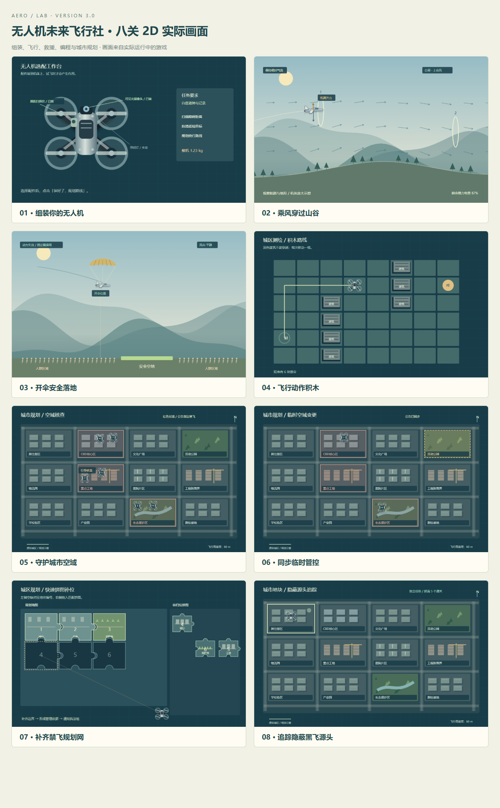

# 无人机未来飞行社 · 3.0 全 2D 重构

八关无人机科学与城市空域探索。面向 10–14 岁，全部游戏画面使用 Canvas 2D。无需联网即可游玩。

入口：
- 源文件：index.html
- 离线成品：dist/index.html（运行 npm run build 生成；仓库也包含成品）
- 本地预览：npm run dev → http://127.0.0.1:4188/

| 主关 | 操作 | 科普如何影响结果 |
|---|---|---|
| 1 组装无人机 | 配件选配、规划航点、实际试飞 | 扫描仪采集距离；摄像头记录目标；夜间照明影响记录；电池与载重改变耗电 |
| 2 山谷固定翼 | 抬/压机头、按需增加推力 | 相对气流、迎角、升力、阻力、重力与推力每步计算；地形、昼夜改变风场 |
| 3 开伞救援 | 判断开伞时机、开伞后小幅修正 | 动力失效后仍有空速；降落伞逐渐展开，减速与漂移影响落点；失败显示对应安全知识 |
| 4 积木编程 | 拖拽/添加方向与步数积木、运行和修改 | 指令按序执行，路径与建筑碰撞一致；内嵌三张递进地图 |
| 5 空域管理员 | 核查无人机与授权、通知执法组 | 依据明确划定的虚拟禁飞区域与许可；合法误拦扣分；通关解锁合法空域地图 |
| 6 临时变更 | 勾选生效图层并同步、混飞核查 | 永久与临时分开；活动区生效、新围界与解除会改变有效规则 |
| 7 规划拼图 | 拖拼图补空缺 | 匹配地块边界与地标；补错预警，漏补形成排查盲区 |
| 8 地块追踪 | 读取用途线索、扫描信号、授权核验 | 用途只作线索；核验许可区域与时段，定位五个源头直接通关 |

每个主关三种递进任务；第四关包含主地图加两张内嵌地图。第八关始终独立进入，不读取前关道具。重构后的成绩使用独立 v3 存档，不把旧版成绩当作新关成绩。

## 辅助与演示
- 同一个任务实际失败 12 次后，操作台提供“换个节奏：开启练习辅助”。不弹羞辱提示，不自动通关。
- 第一关提供可选参考航线，仍需正确选配并亲手试飞。
- 第二关增加航路容错、减弱风；第三关缩短开伞展开时间、减弱侧风。
- 第四关提供可选绕行参考；城市关降低移动与时间压力；拼图延长窗口。
- 辅助模式也检查全部任务条件，闲置不会通关。
- “看这关的操作演示”使用独立实例，执行同一组操作与物理，暂停并保留原任务，不写成绩。
- “看真实无人机起飞”保留 NASA 实拍，视频源和授权见页面。真实录像与教学模拟明确标示。

## 科学边界
第二关为二维准定常教学模型，SI 单位、固定 1/120 秒步长；升力依据相对空速平方和迎角，阻力含基础与诱导项，超过失速迎角后升力逐渐下降。并非用于真实飞行操纵、CFD 或适航验证。机体放大示意以便观察，地形碰撞按安全离地高度判断。降落伞使用简化的可控救援伞模型。

城市的 CBD、工地和保护区限制以游戏内具体划定的虚拟公告为准，并不一概等同于现实禁飞区。报备接收与飞行许可分开核验。拦截表现为管理员通知执法组后的模拟处置，不教授干扰或夺控。拼图是管理地图，不能产生实体屏障。

参考课件保留了“动手观察无人机怎样执行任务”的科普方向；具体内容与玩法见上表。

## 验证
- npm test：模型 24 路线 + 浏览器 24 控件通关，闲置、暂停、报告与存档
- npm run test:offline：离线成品同样的浏览器操作验证
- npm run test:science：气动、昼夜风、开伞、配件、规则、边界、难度与辅助不变量
- npm run test:practice：每款第三任务真实失败 12 次，开启辅助后实际操作通关
- npm run test:smoke：Chrome 真实加载、闲置、鼠标及键盘输入
- npm run test:demos：24 个演示的完成、计分隔离与原任务恢复
- npm run test:visual：360 / 414 / 768 / 1440 宽度无横向溢出
- node v3-media-check.mjs：离线视频解码与播放、任务暂停、画面预览

构建和游玩不需要第三方运行库。构建需要 Node.js 22 或更新版本。浏览器测试先运行 npm install，使用 Playwright 1.58.2 和本机 Chrome；也可设置 CHROME_EXECUTABLE_PATH 指向浏览器，或设置 BROWSER_CHANNEL=chromium 使用 npx playwright install chromium 安装的浏览器。PLAYWRIGHT_MODULE_PATH 可指定已有 Playwright 包目录。

双击 dist/index.html 即可离线游玩；开发时运行 npm run dev。服务器仅提供本仓库内的文件，PORT 环境变量可修改默认 4188 端口。

源码：reboot-content.js / physics2d.js / reboot-art.js / reboot-games.js / reboot-app.js / reboot.css。

科研素材的作者、授权和来源保留在 assets/photos/sources.json、demo-media.js 与页面的“图片与科学依据”中；字体授权见 assets/OFL.txt。
